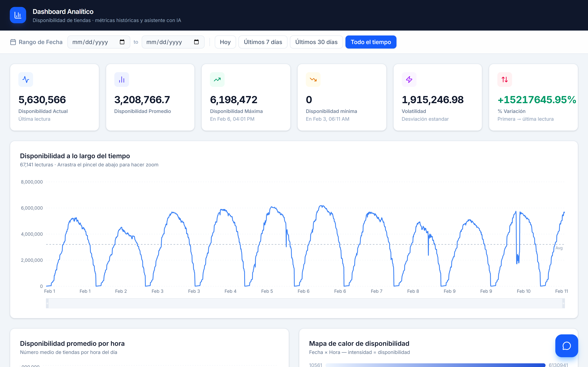
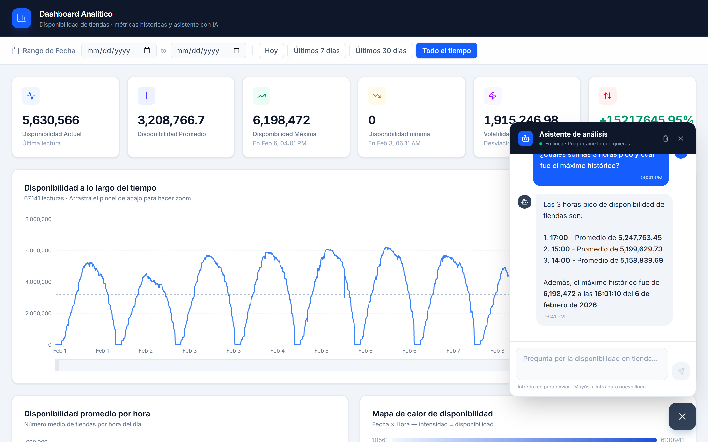
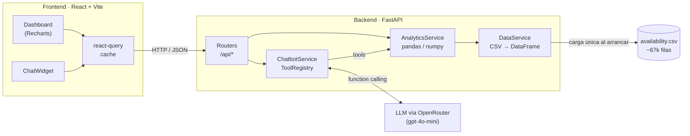
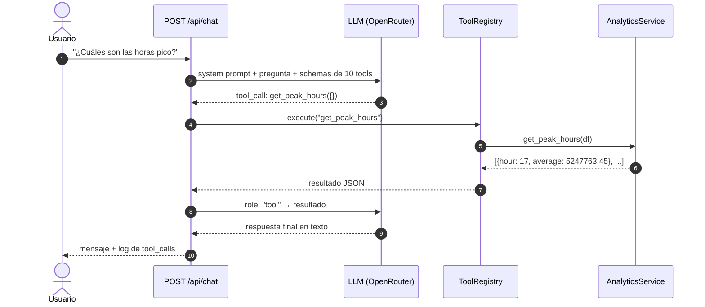
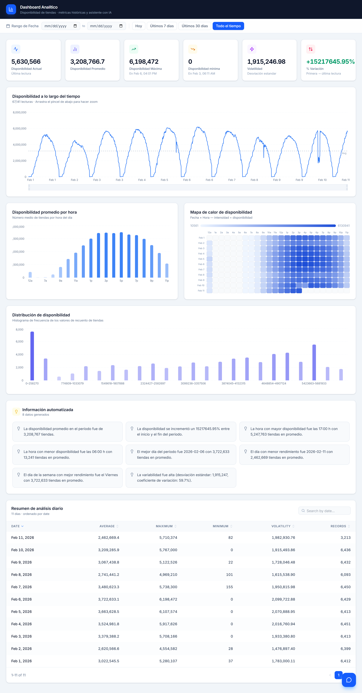
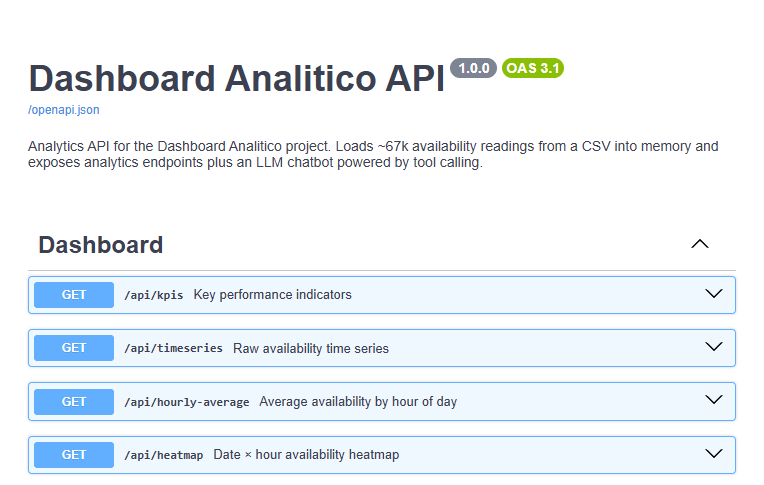

<div align="center">


# Dashboard Analítico

**Analítica de series temporales con un asistente de IA que responde con datos reales, no con alucinaciones.**

Explora ~67.000 lecturas de disponibilidad de tiendas con KPIs, gráficos interactivos y un chatbot
que usa *tool calling*. El LLM nunca inventa un número: cada cifra sale de una función analítica.


[Características](#-características) ·
[Arquitectura](#-arquitectura) ·
[Inicio rápido](#-inicio-rápido) ·
[Documentación](#-documentación) ·
[Roadmap](#-roadmap)

<br />



</div>

---

## ✨ Características

<table>
<tr>
<td width="50%" valign="top">

### 📊 Dashboard interactivo
- **6 KPIs**: valor actual, promedio, máximo, mínimo, variación % y volatilidad
- **Serie temporal** con zoom por rango (*brush*)
- **Promedio por hora** del día y **heatmap** fecha × hora
- **Histograma** de distribución de valores
- **Insights automáticos** en lenguaje natural
- **Tabla diaria** con orden, búsqueda y paginación
- Filtros de fecha globales: todo se recalcula al cambiar el rango

</td>
<td width="50%" valign="top">

### 🤖 Asistente con IA
- Preguntas en lenguaje natural, en español o inglés
- **Tool calling** con 10 herramientas analíticas
- Bucle agéntico: el modelo puede encadenar varias herramientas
- Entiende fechas relativas ("primera semana de febrero")
- Devuelve el **log de herramientas usadas** para trazabilidad
- Funciona con cualquier modelo de [OpenRouter](https://openrouter.ai)
- Si no hay API key, el dashboard sigue funcionando

</td>
</tr>
</table>

<div align="center">

<sub>El asistente consultó <code>get_peak_hours</code> y <code>get_maximum</code> antes de responder.</sub>
</div>

---

## 🏗 Arquitectura



**Decisiones clave**

| Decisión | Por qué |
|---|---|
| El CSV se carga **una sola vez** en el `lifespan` de FastAPI | Consultas en milisegundos sin base de datos; el dataset cabe en memoria |
| Columnas derivadas (`hour`, `weekday`, `date`…) calculadas al cargar | Ningún endpoint vuelve a calcularlas |
| Servicios inyectados vía `app.state` + `Depends` | Capas desacopladas y fáciles de testear |
| El LLM **solo ve el JSON** que devuelven las herramientas | Sin alucinaciones numéricas y con pocos tokens por petición |
| Un hook de react-query por endpoint, con los filtros como *query key* | Cambiar el rango de fechas refresca todo y la caché evita peticiones repetidas |

👉 Detalle completo en [docs/ARCHITECTURE.md](docs/ARCHITECTURE.md).

### Cómo responde el chatbot



👉 Cómo funciona y cómo agregar herramientas: [docs/CHATBOT.md](docs/CHATBOT.md).

---

## 🚀 Inicio rápido

### Requisitos

- **Python** 3.10 o superior
- **Node.js** 20 o superior
- *(Opcional)* Una API key de [OpenRouter](https://openrouter.ai/keys) para el chatbot

### 1. Clonar

```bash
git clone https://github.com/diazperillaj/Dashboard-con-LLM.git
cd Dashboard-con-LLM
```

### 2. Backend

```bash
cd backend
python -m venv env
env\Scripts\activate            # Windows
# source env/bin/activate       # macOS / Linux
pip install -r requirements.txt

cp .env.example .env            # y agrega tu OPENROUTER_API_KEY
uvicorn app.main:app --reload --port 8000
```

### 3. Frontend

```bash
cd frontend
npm install
npm run dev
```

| Servicio | URL |
|---|---|
| Dashboard | http://localhost:5173 |
| API | http://localhost:8000 |
| Swagger UI | http://localhost:8000/docs |
| ReDoc | http://localhost:8000/redoc |

> 💡 **Windows:** cuando las dependencias ya estén instaladas, `run.bat` levanta backend y frontend en dos ventanas.

---

## 🔌 API

Todos los endpoints de analítica aceptan los filtros opcionales `start_date` y `end_date` (`YYYY-MM-DD`, inclusivos).

| Método | Endpoint | Devuelve |
|---|---|---|
| `GET` | `/api/kpis` | Actual, promedio, máx/mín (con timestamp), variación %, volatilidad |
| `GET` | `/api/timeseries` | Serie cruda `{timestamp, value}` |
| `GET` | `/api/hourly-average` | Promedio por hora del día (0–23) |
| `GET` | `/api/heatmap` | Promedio por celda fecha × hora |
| `GET` | `/api/distribution` | Histograma (`bins` entre 5 y 200) |
| `GET` | `/api/table` | Resumen por día |
| `GET` | `/api/insights` | Insights en lenguaje natural |
| `POST` | `/api/chat` | Respuesta del asistente + log de herramientas |
| `GET` | `/health` | Estado del servicio |

```bash
curl "http://localhost:8000/api/kpis?start_date=2026-02-03&end_date=2026-02-05"
```

```json
{
  "current": 1397752,
  "average": 3522670.7,
  "maximum": 6107574,
  "maximum_timestamp": "2026-02-05T16:01:10",
  "minimum": 0,
  "minimum_timestamp": "2026-02-03T06:11:20",
  "variation_percent": 65.9819,
  "volatility": 2011065.41
}
```

👉 Referencia completa con ejemplos y códigos de error: [docs/API.md](docs/API.md).

---

## 🧰 Stack

| Capa | Tecnologías |
|---|---|
| **Backend** | FastAPI · Uvicorn · pandas · numpy · Pydantic v2 · pydantic-settings |
| **IA** | OpenAI SDK sobre OpenRouter · function / tool calling · `gpt-4o-mini` por defecto |
| **Frontend** | React 19 · TypeScript · Vite · Tailwind CSS 4 · Recharts · TanStack Query · Axios · lucide-react |
| **Datos** | CSV unificado (67.141 lecturas, muestreo cada 10 s) generado por un script ETL propio |

---

## 📁 Estructura del proyecto

```
Dashboard-con-LLM/
├── backend/
│   ├── app/
│   │   ├── main.py              # App factory, lifespan, CORS, routers
│   │   ├── core/config.py       # Settings (.env)
│   │   ├── api/                 # Routers: dashboard.py, chatbot.py
│   │   ├── services/            # DataService · AnalyticsService · ChatbotService
│   │   ├── schemas/schemas.py   # Modelos Pydantic de request/response
│   │   └── data/availability.csv
│   ├── data.py                  # ETL: CSV crudos → availability.csv
│   └── requirements.txt
├── frontend/
│   └── src/
│       ├── pages/               # DashboardPage
│       ├── components/
│       │   ├── dashboard/       # KPIs, gráficos, insights, tabla, filtros
│       │   └── chatbot/         # Widget, ventana, mensajes, input
│       ├── hooks/               # Un hook de react-query por endpoint
│       ├── services/api.ts      # Cliente Axios
│       └── types/api.ts         # Tipos de las respuestas
├── docs/                        # Documentación técnica + capturas
└── run.bat                      # Arranque rápido en Windows
```

---

## 📚 Documentación

| Documento | Contenido |
|---|---|
| [ARCHITECTURE.md](docs/ARCHITECTURE.md) | Capas, ciclo de vida, flujo de datos, decisiones de diseño |
| [API.md](docs/API.md) | Todos los endpoints con parámetros, ejemplos y errores |
| [CHATBOT.md](docs/CHATBOT.md) | Tool calling, bucle agéntico, catálogo de herramientas, cómo extenderlo |
| [DATA.md](docs/DATA.md) | Dataset, pipeline ETL y definición de cada métrica |
| [DEVELOPMENT.md](docs/DEVELOPMENT.md) | Instalación, variables de entorno, scripts y solución de problemas |

<details>
<summary><b>📸 Ver el dashboard completo</b></summary>
<br />

</details>

<details>
<summary><b>📸 Ver la documentación interactiva (Swagger)</b></summary>
<br />

</details>

---

## 🗺 Roadmap

- [ ] Tests unitarios para `AnalyticsService` y para el bucle de tool calling (con un LLM simulado)
- [ ] Historial de conversación en el chat (respuestas con contexto)
- [ ] Respuestas del chat en *streaming* (SSE)
- [ ] Mostrar en la UI qué herramientas usó el asistente
- [ ] Docker Compose para levantar todo con un solo comando
- [ ] Pipeline de CI (lint + type-check + tests)
- [ ] Muestreo de la serie temporal en el backend para rangos grandes
- [ ] Modo oscuro

---

## 📄 Licencia

Distribuido bajo licencia MIT. Ver [LICENSE](LICENSE).

<div align="center">
<sub>Hecho con FastAPI, React y mucho café ☕</sub>
</div>
