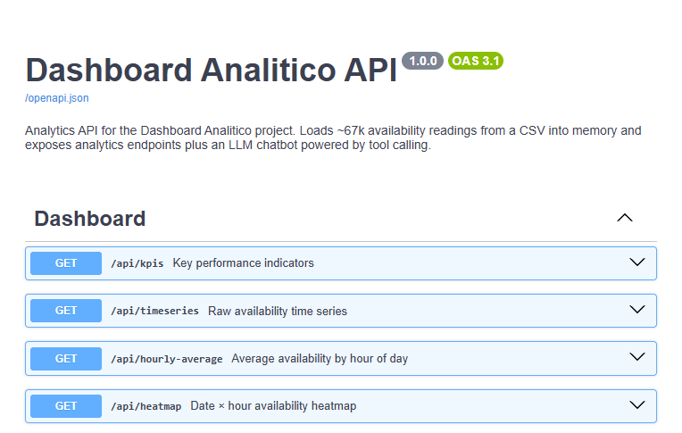

# Referencia de la API

URL base en desarrollo: `http://localhost:8000`

La documentación interactiva se genera sola a partir de los schemas Pydantic:

- **Swagger UI:** `/docs`
- **ReDoc:** `/redoc`
- **OpenAPI JSON:** `/openapi.json`



---

## Convenciones

### Filtros de fecha

Todos los endpoints `GET /api/*` aceptan:

| Parámetro | Tipo | Descripción |
|---|---|---|
| `start_date` | `YYYY-MM-DD` | Incluye lecturas desde este día (inclusive) |
| `end_date` | `YYYY-MM-DD` | Incluye lecturas hasta este día (inclusive) |

Los dos son opcionales. Sin filtros se usa el dataset completo.

### Errores

| Código | Cuándo | Cuerpo |
|---|---|---|
| `404` | El rango de fechas no tiene datos | `{"detail": "No data found for the selected date range. Try widening the filter."}` |
| `422` | Parámetro inválido (fecha mal formada, `bins` fuera de rango, `message` vacío) | Error de validación estándar de FastAPI |
| `500` | Error inesperado o del proveedor LLM en `/api/chat` | `{"detail": "An error occurred while processing your message."}` |
| `503` | `/api/chat` sin `OPENROUTER_API_KEY` configurada | `{"detail": "OPENROUTER_API_KEY is not configured. …"}` |

Timestamps en ISO-8601 sin zona horaria (`2026-02-05T16:01:10`).

---

## Endpoints

### `GET /api/kpis`

Indicadores del período seleccionado.

```bash
curl "http://localhost:8000/api/kpis?start_date=2026-02-03&end_date=2026-02-05"
```

```json
{
  "current": 1397752,
  "average": 3522670.7,
  "maximum": 6107574,
  "maximum_timestamp": "2026-02-05T16:01:10",
  "minimum": 0,
  "minimum_timestamp": "2026-02-03T06:11:20",
  "variation_percent": 65.9819,
  "volatility": 2011065.41
}
```

| Campo | Definición |
|---|---|
| `current` | Última lectura del período |
| `average` | Media aritmética |
| `maximum` / `maximum_timestamp` | Valor máximo y cuándo ocurrió |
| `minimum` / `minimum_timestamp` | Valor mínimo y cuándo ocurrió |
| `variation_percent` | `(última − primera) / primera × 100` (0 si la primera es 0) |
| `volatility` | Desviación estándar muestral |

---

### `GET /api/timeseries`

Todas las lecturas del período, en orden cronológico.

```bash
curl "http://localhost:8000/api/timeseries?start_date=2026-02-03&end_date=2026-02-03"
```

```json
[
  { "timestamp": "2026-02-03T00:00:00", "value": 842111 },
  { "timestamp": "2026-02-03T00:00:10", "value": 840917 },
  { "timestamp": "2026-02-03T00:00:20", "value": 836419 }
]
```

> ⚠️ Un día completo son ~6.400 puntos y el dataset entero ~67.000. Conviene filtrar por fecha cuando el cliente no necesita todo.

---

### `GET /api/hourly-average`

Media por hora del día. Solo aparecen las horas que tienen datos.

```json
[
  { "hour": 0,  "average": 476855.55 },
  { "hour": 6,  "average": 13207.43 },
  { "hour": 16, "average": 5636292.66 }
]
```

---

### `GET /api/heatmap`

Media por celda (fecha, hora), lista para pintar un heatmap.

```json
[
  { "date": "2026-02-03", "hour": 15, "value": 5566834.75 },
  { "date": "2026-02-03", "hour": 16, "value": 5636292.66 }
]
```

---

### `GET /api/distribution`

Histograma calculado con `numpy.histogram`.

| Parámetro extra | Tipo | Default | Rango |
|---|---|---|---|
| `bins` | int | `20` | 5–200 |

```bash
curl "http://localhost:8000/api/distribution?bins=5"
```

```json
{
  "bins":   [0.0, 1239694.4, 2479388.8, 3719083.2, 4958777.6, 6198472.0],
  "counts": [14280, 9813, 10580, 16914, 15554]
}
```

`bins` trae los `n + 1` bordes y `counts[i]` es la frecuencia del intervalo `[bins[i], bins[i+1])`.

---

### `GET /api/table`

Resumen por día.

```json
[
  {
    "date": "2026-02-03",
    "average": 3379388.15,
    "maximum": 5708166,
    "minimum": 0,
    "volatility": 1933380.8,
    "records": 6413
  }
]
```

---

### `GET /api/insights`

Observaciones generadas con reglas (sin LLM) a partir del período: promedio, variación, horas pico y valle, mejor y peor día, mejor día de la semana y nivel de variabilidad.

```json
{
  "insights": [
    "La disponibilidad promedio en el período fue de 3,522,671 tiendas.",
    "La hora con mayor disponibilidad fue las 16:00 h con 5,841,864 tiendas en promedio.",
    "La variabilidad fue alta (desviación estándar: 2,011,065, coeficiente de variación: 57.1%)."
  ]
}
```

---

### `POST /api/chat`

Pregunta en lenguaje natural al asistente.

**Request**

```json
{ "message": "¿Cuáles son las 3 horas pico y cuál fue el máximo histórico?" }
```

**Response**

```json
{
  "message": "Las 3 horas pico son: 17:00, 15:00 y 14:00 … El máximo histórico fue de 6,198,472 el 6 de febrero de 2026 a las 16:01:10.",
  "tools_available": ["compare_periods", "get_average", "get_current", "…"],
  "tool_calls": [
    {
      "tool": "get_peak_hours",
      "parameters": {},
      "result": { "peak_hours": [{ "hour": 17, "average": 5247763.45 }, "…"] }
    },
    {
      "tool": "get_maximum",
      "parameters": {},
      "result": { "maximum": 6198472, "timestamp": "2026-02-06T16:01:10" }
    }
  ],
  "status": "ok"
}
```

| Campo | Descripción |
|---|---|
| `message` | Respuesta final del modelo |
| `tools_available` | Herramientas registradas |
| `tool_calls` | Cada herramienta que el modelo ejecutó, con sus parámetros y resultado |
| `status` | `ok` si se completó |

---

### `GET /health`

```json
{ "status": "ok", "version": "1.0.0" }
```
