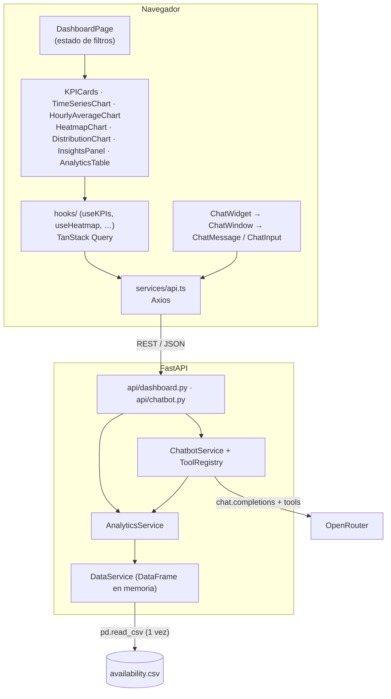
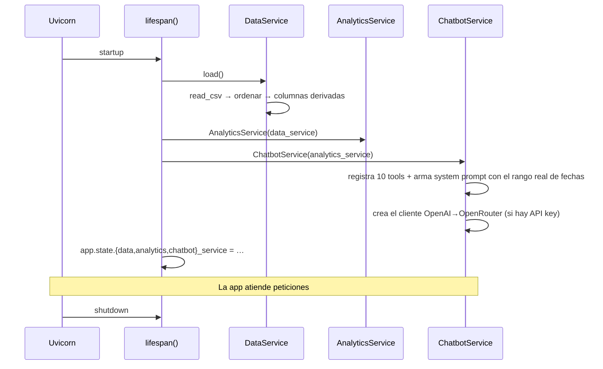
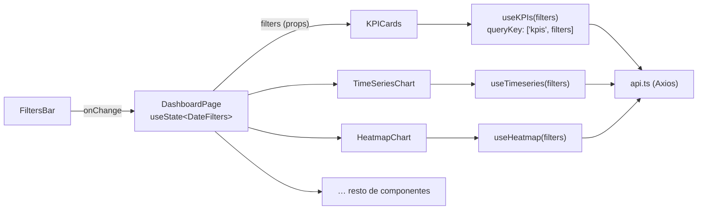

# Arquitectura

Dashboard Analítico es una aplicación cliente-servidor en dos piezas:

- **Backend** en FastAPI: carga el dataset en memoria y expone la analítica por HTTP.
- **Frontend** en React: muestra los datos y aloja el asistente conversacional.

Ninguna de las dos usa base de datos. El dataset (~67k filas, unos pocos MB) cabe de sobra en memoria, así que pandas sirve como motor de consultas.

---

## Vista general



---

## Backend

### Capas

| Capa | Archivo | Qué hace | Qué no hace |
|---|---|---|---|
| **Routers** | `app/api/*.py` | Validan parámetros (Pydantic / `Query`), resuelven dependencias y traducen errores a HTTP | No calculan métricas |
| **AnalyticsService** | `app/services/analytics_service.py` | Filtra por fechas y calcula todas las métricas con pandas/numpy | No sabe nada de HTTP ni del LLM |
| **ChatbotService** | `app/services/chatbot_service.py` | Registra herramientas y orquesta el bucle con el LLM | No toca el DataFrame directamente |
| **DataService** | `app/services/data_service.py` | Lee el CSV, valida columnas, ordena y agrega columnas derivadas | No filtra ni agrega |
| **Schemas** | `app/schemas/schemas.py` | Contratos de entrada y salida (y la documentación OpenAPI) | — |
| **Config** | `app/core/config.py` | `Settings` con pydantic-settings: lee `.env` y variables de entorno | — |

### Ciclo de vida



Todo se construye **una sola vez**. Los routers obtienen los servicios con `Depends`:

```python
def get_analytics(request: Request) -> AnalyticsService:
    return request.app.state.analytics_service
```

Así no hay estado global y en los tests se puede reemplazar cualquier servicio con `app.dependency_overrides`.

### Patrón de cada endpoint

Todos los endpoints de analítica siguen el mismo flujo:

1. `analytics.get_filtered_data(start_date, end_date)`: devuelve una vista filtrada. Si queda vacía lanza `ValueError`, que el router convierte en **404**.
2. Una o varias funciones de `AnalyticsService` sobre esa vista.
3. Serialización con el schema Pydantic correspondiente.

### Columnas derivadas

`DataService.load()` agrega estas columnas al cargar, para no recalcularlas en cada petición:

| Columna | Origen | Uso |
|---|---|---|
| `date` | `timestamp.dt.date` | Filtros, heatmap, tabla diaria |
| `hour` | `timestamp.dt.hour` | Promedio por hora, horas pico |
| `weekday` / `weekday_name` | `dayofweek` / `day_name()` | Insight del mejor día de la semana |
| `week` | `isocalendar().week` | Agregados semanales (disponible) |
| `month` | `timestamp.dt.month` | Agregados mensuales (disponible) |

---

## Frontend

### Flujo de datos



- **Una sola fuente de verdad**: el rango de fechas vive en `DashboardPage` y llega a los componentes por props.
- **Un hook por endpoint**: los filtros forman parte del `queryKey`, así que cambiar el rango invalida todas las consultas, y volver a un rango ya visto se sirve desde caché (`staleTime: 30s`).
- **Cliente centralizado**: `services/api.ts` limpia los filtros vacíos y lee la URL base de `VITE_API_URL`.
- **Tipos compartidos**: `types/api.ts` replica los schemas Pydantic del backend.

### Chat

`ChatWidget` guarda el historial de mensajes en estado local y llama a `POST /api/chat` con el último mensaje. El backend no guarda estado entre peticiones: cada pregunta se responde por separado. Ver [CHATBOT.md](CHATBOT.md).

---

## Decisiones de diseño y trade-offs

| Decisión | Ventaja | Costo / límite |
|---|---|---|
| Dataset en memoria con pandas | Latencia mínima, cero infraestructura | No escala a datasets que no quepan en RAM; los datos son de solo lectura |
| Sin base de datos | Despliegue trivial | Para datos en vivo habría que agregar un store (TimescaleDB, DuckDB, …) |
| `/api/timeseries` devuelve todos los puntos | Máxima fidelidad en el gráfico | Payload grande en rangos amplios (ver roadmap: muestreo en el servidor) |
| LLM con *tool calling* en lugar de pasarle los datos | Números exactos, pocos tokens, auditable | Depende de que el modelo elija bien la herramienta |
| Chat sin historial en el servidor | Stateless y simple | No hay preguntas de seguimiento con contexto |
| OpenRouter como proveedor | Se cambia de modelo con una variable de entorno | Dependencia de un servicio externo para el chat |
