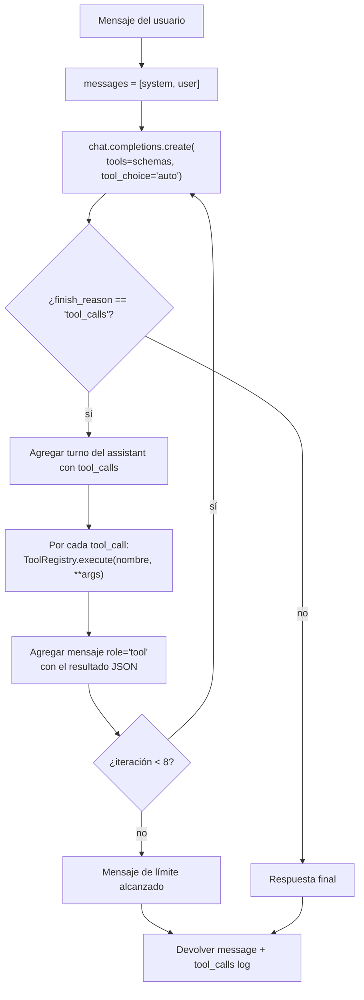

# Asistente con IA: tool calling

El asistente responde preguntas sobre el dataset **sin ver nunca los datos crudos**. El LLM solo decide *qué* calcular. El cálculo lo hace `AnalyticsService` y el modelo redacta la respuesta con ese resultado.

```
Usuario → LLM → elige herramienta(s) → AnalyticsService → JSON → LLM → respuesta
```

Así se consiguen tres cosas:

- **Exactitud**: las cifras vienen de pandas, no del modelo.
- **Costo bajo**: el modelo recibe unos cientos de bytes de JSON, no 67.000 filas.
- **Trazabilidad**: cada respuesta incluye el log de herramientas ejecutadas.

---

## El bucle agéntico

Implementado en `ChatbotService.process_message()` ([chatbot_service.py](../backend/app/services/chatbot_service.py)).



**Protecciones**

| Riesgo | Mitigación |
|---|---|
| Bucle infinito de herramientas | Máximo de 8 iteraciones (`_MAX_TOOL_ITERATIONS`) |
| Una herramienta lanza excepción (p. ej. rango sin datos) | Se captura y se devuelve `{"error": "..."}` al modelo, que puede explicarlo o reintentar |
| El modelo pide fechas fuera del dataset | El *system prompt* incluye el rango real de fechas, calculado al arrancar |
| Falta la API key | El servicio arranca igual y `/api/chat` responde **503**; el dashboard no se ve afectado |

---

## System prompt

Se construye al arrancar con el rango real del dataset. Pide al modelo que:

- use **siempre** las herramientas y nunca estime números;
- responda en el idioma del usuario;
- convierta expresiones como "primera semana de febrero" a `start_date` / `end_date`;
- use `compare_periods` para comparaciones;
- avise claramente cuando no haya datos.

---

## Catálogo de herramientas

Todas aceptan `start_date` y `end_date` opcionales (`YYYY-MM-DD`), salvo donde se indica.

| Herramienta | Devuelve | Ejemplo de pregunta |
|---|---|---|
| `get_average` | `{average}` | "¿Cuál fue el promedio el 5 de febrero?" |
| `get_maximum` | `{maximum, timestamp}` | "¿Cuándo fue el pico máximo?" |
| `get_minimum` | `{minimum, timestamp}` | "¿Cuál fue el valor más bajo de la semana?" |
| `get_current` | `{current}` | "¿Cuál es la última lectura?" |
| `get_variation` | `{variation_percent}` | "¿Cuánto cambió entre el inicio y el fin?" |
| `get_volatility` | `{volatility}` | "¿Qué tan estable fue el 3 de febrero?" |
| `compare_periods` ⚑ | promedio actual vs. período anterior de igual duración + `change_percent` | "Compara del 6 al 8 con los días anteriores" |
| `get_hourly_pattern` | promedio por hora 0–23 | "¿Cómo se comporta a lo largo del día?" |
| `get_peak_hours` | top-3 horas con mayor promedio | "¿Cuáles son las horas pico?" |
| `get_low_hours` | top-3 horas con menor promedio | "¿A qué hora hay menos disponibilidad?" |

⚑ `compare_periods` **requiere** `start_date` y `end_date`.

---

## Agregar una herramienta nueva

1. **Implementa el cálculo** en `AnalyticsService` (recibe un DataFrame ya filtrado):

   ```python
   def get_weekday_average(self, df: pd.DataFrame) -> list[dict]:
       grouped = df.groupby("weekday_name")["value"].mean()
       return [{"weekday": d, "average": round(float(v), 2)} for d, v in grouped.items()]
   ```

2. **Expónla como tool** dentro de `ChatbotService._register_tools()`:

   ```python
   def get_weekday_pattern(start_date=None, end_date=None) -> dict:
       df = _filtered(start_date, end_date)
       return {"weekday_pattern": analytics.get_weekday_average(df)}

   tools.append(Tool(
       name="get_weekday_pattern",
       description="Return the average store availability for each day of the week.",
       parameters_schema=_DATE_RANGE_SCHEMA,
       handler=get_weekday_pattern,
   ))
   ```

3. Reinicia el backend. El log de arranque lista las herramientas registradas y el modelo empieza a usarla sin cambiar nada más.

> **Tip:** la `description` es lo que el modelo lee para decidir cuándo usar la herramienta. Escríbela en inglés, en una línea y diciendo qué devuelve.

---

## Cambiar de modelo

Cualquier modelo de OpenRouter con soporte de *tools* sirve:

```env
OPENROUTER_MODEL=openai/gpt-4o-mini   # default
```

La lista de modelos y sus identificadores está en [openrouter.ai/models](https://openrouter.ai/models) (filtra por *tools*).

Como el cliente es el SDK oficial de OpenAI apuntando a `OPENROUTER_BASE_URL`, también se puede usar la API de OpenAI directamente o cualquier servidor compatible (Ollama, vLLM, LM Studio) cambiando esa URL.

---

## Limitaciones conocidas

- **Sin memoria de conversación**: cada mensaje se procesa por separado. Una pregunta de seguimiento ("¿y el día anterior?") no conoce el contexto previo.
- **Sin streaming**: la respuesta llega completa al final del bucle.
- **Sin rate limiting** en `/api/chat`.
