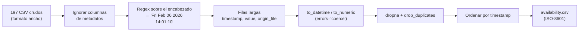

# Datos y métricas

## El dataset

`backend/app/data/availability.csv`: una fila por lectura, con muestreo cada **10 segundos**.

| Columna | Tipo | Descripción |
|---|---|---|
| `timestamp` | ISO-8601 | Momento de la lectura |
| `value` | int | Número de tiendas disponibles en ese instante |
| `origin_file` | string | Archivo crudo del que salió la lectura (trazabilidad) |

```csv
timestamp,value,origin_file
2026-02-01T06:11:20,37,AVAILABILITY-data.csv
2026-02-01T06:11:30,195,AVAILABILITY-data.csv
```

| Propiedad | Valor |
|---|---|
| Lecturas | 67.141 |
| Rango | 2026-02-01 06:11 → 2026-02-11 15:00 |
| Lecturas por día completo | ~6.400 |
| Archivos de origen | 197 CSV crudos |

### Patrón observable

La serie tiene un **ciclo diario muy marcado**: cae casi a cero de madrugada (entre las 01:00 y las 06:00 no hay lecturas), sube durante la mañana, llega al máximo entre las 15:00 y las 17:00 y baja por la noche. Por eso el heatmap fecha × hora y el promedio por hora son las vistas más informativas.

---

## Pipeline ETL

Los datos originales venían en un formato **ancho**: cada CSV tenía una sola fila de valores y **cada columna era un timestamp**, con encabezados que empiezan por `Fri Feb 06 2026 14:01:10` (seguido de texto adicional), más algunas columnas de metadatos.

[`backend/data.py`](../backend/data.py) los convierte al formato largo:



```bash
cd backend
python data.py --input ../Data/Archivo --output app/data/availability.csv
```

| Paso | Por qué |
|---|---|
| Regex `^[A-Za-z]{3}\s+[A-Za-z]{3}\s+\d{2}\s+\d{4}\s+\d{2}:\d{2}:\d{2}` | Los encabezados traen texto adicional; solo interesa la parte fecha-hora |
| `errors="coerce"` | Un valor corrupto se vuelve `NaN` y se descarta, en vez de romper todo el lote |
| `drop_duplicates(["timestamp","value"])` | Los archivos exportados se solapan en el tiempo |
| Un `try/except` por archivo | Un CSV dañado se reporta y el resto sigue procesándose |

> La carpeta de CSV crudos (`Data/`) no se versiona. Solo se incluye el dataset unificado.

---

## Definición de métricas

Todas se calculan en `AnalyticsService` sobre el DataFrame ya filtrado por fechas.

| Métrica | Fórmula | Notas |
|---|---|---|
| **Actual** | `value.iloc[-1]` | Última lectura del período |
| **Promedio** | `value.mean()` | Redondeado a 2 decimales |
| **Máximo / Mínimo** | `idxmax()` / `idxmin()` | Incluye el timestamp en que ocurrió |
| **Variación %** | `(última − primera) / primera × 100` | Devuelve 0 si la primera es 0 |
| **Volatilidad** | `value.std()` | Desviación estándar muestral (ddof = 1) |
| **Coef. de variación** | `std / mean × 100` | En insights: < 5 % baja, 5–15 % moderada, ≥ 15 % alta |
| **Promedio por hora** | `groupby("hour").mean()` | |
| **Heatmap** | `groupby(["date","hour"]).mean()` | |
| **Distribución** | `numpy.histogram(value, bins)` | |
| **Resumen diario** | `groupby("date").agg(mean, max, min, std, count)` | |
| **Comparación de períodos** | media del período vs. media de los N días anteriores | `change_percent = null` si no hay datos previos |

### Sobre la variación %

La variación compara **solo dos puntos**: la primera y la última lectura. Con el ciclo diario del dataset, un período que empieza de madrugada (valor cercano a 0) da porcentajes enormes. Por ejemplo, el dataset completo empieza en `37` y termina en `5.630.566`, lo que da +15.217.645 %. Es correcto según la definición, pero para comparar períodos tiene más sentido `compare_periods`, que compara promedios.
